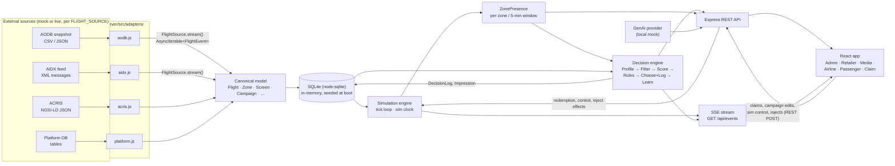

# Architecture

Deep design for the Airport Retail Media Platform. For setup and the demo
script see the [README](../README.md); for the endpoint-by-endpoint reference
see [api.md](api.md); for connecting real data sources see
[adapter-guide.md](adapter-guide.md). The build contract is
[CONTRACT.md](CONTRACT.md) — where this document and the contract disagree,
the contract wins.

## Contents

- [Design principles](#design-principles)
- [System overview & data flow](#system-overview--data-flow)
- [Canonical model](#canonical-model)
- [Adapter pattern](#adapter-pattern)
- [Simulation engine](#simulation-engine)
- [ZonePresence](#zonepresence)
- [Decision engine](#decision-engine)
- [Determinism & audit](#determinism--audit)
- [SSE event catalogue](#sse-event-catalogue)
- [Persistence](#persistence)
- [GenAI provider](#genai-provider)
- [Performance posture](#performance-posture)
- [Contract vs. brief differences](#contract-vs-brief-differences)

---

## Design principles

1. **Canonical model only.** The application core — simulation, presence,
   decision engine, KPIs, APIs — only ever sees canonical entities.
   Source-specific shapes (AODB columns, AIDX XML, NGSI-LD context) exist
   exclusively inside adapters.
2. **One process, one service.** A single Node process ingests, simulates,
   decides and serves. That is what makes `docker compose up` a complete
   deployment and keeps event latency (target: visible effect < 2 s) a matter
   of an in-process function call plus an SSE write.
3. **Deterministic by construction.** The seed uses a seeded RNG
   (mulberry32, seed `42`); the decision engine is a pure function of logged
   inputs. Given the same sim minute and the same logged inputs, a decision
   reproduces exactly — that is what makes the Gate 42 / 14:10 worked example
   a test rather than a hope.
4. **Everything explainable.** No ad plays without a `DecisionLog` row
   carrying the crowd profile, every candidate's scores, the winning reason
   and an evidence trail (source, detail, freshness) behind it.

---

## System overview & data flow



### A decision's journey, step by step

1. An adapter emits a source event — e.g. an AIDX message delaying XY501 by
   45 minutes — translated to a canonical `FlightEvent`.
2. The canonical `Flight` is updated in SQLite; the simulation engine marks
   the affected zones dirty.
3. `ZonePresence` for the Gate 42 catchment is recomputed: 240 delayed
   passengers now dwell longer, so presence and median dwell rise.
4. On the next decision slot the engine profiles the catchment, filters and
   scores the eligible campaigns, applies business rules (the delay boost),
   chooses a winner and writes a `DecisionLog` with its evidence trail.
5. The decision is pushed over SSE (`decision`, plus `presence` and
   `flight` events); the passenger screen swaps its playlist, dashboards
   update — end-to-end target **< 2 s** from the injected event.
6. A passenger scans the promo QR and claims it; the `Redemption` updates the
   campaign's conversion estimates (the *Learn* step) and the Retailer
   dashboard live (`redemption` event).

---

## Canonical model

The canonical entities are fixed by the contract. Nothing outside an adapter
may reference a source field name.

| Entity | Produced from | Notes |
|---|---|---|
| `Flight` | AODB, AIDX | One flight leg: airline, flight number, destination, STD/ETD, status, delay, passengers, load factor, aircraft, terminal/gate (via `GateAssignment`). |
| `GateAssignment` | AODB, AIDX | Flight ↔ gate/stand assignment over time; the link between flights and zones. |
| `AircraftType` | AODB | Aircraft reference data (type, typical capacity). |
| `Terminal` | ACRIS, platform | Top-level spatial container (seed: T1, T2). |
| `Zone` | ACRIS, platform | Sub-terminal area. Seed zone groups per terminal: `checkin`, `security`, `retail`, `gates-low`, `gates-high`. Gate 42 sits in T2 `gates-high`. |
| `Checkpoint` | ACRIS | A measured point in a zone (e.g. a security lane group). |
| `QueueMeasurement` | ACRIS | Timestamped queue/wait observation at a checkpoint; feeds ZonePresence dwell. |
| `Screen` | Platform DB | A display: terminal, zone, gate, size, orientation (16:9 / 9:16), status (online/degraded/offline), latency. Catchment: a screen at gate *G* covers gates *G−2 … G+3*. |
| `Advertiser` | Platform DB | A buying company (retailer brand, airline, etc.). |
| `Vendor` | Platform DB | An operating company running outlets/F&B. |
| `Outlet` | Platform DB | A shop or F&B unit in a zone, owned by a vendor. |
| `Campaign` | Platform DB | Advertiser's buy: creative, zones, audience rules, schedule, budget, segment weights, boost rules, status (draft/pending/active/…). |
| `Creative` | Platform DB | The ad asset content: template, headline, sub-copy, CTA, language. |
| `PromoCode` | Platform DB | Time-boxed offer bound to a campaign/outlet and optionally a flight; carries a share-to-family second code (`shareCode`). |
| `Impression` | Engine | A recorded play of a creative on a screen in a slot. |
| `Redemption` | Claim flow | A recorded promo claim; the input to attributed revenue and the Learn step. |
| `ZonePresence` | Engine (derived) | Per zone per 5-minute window — see below. Never ingested directly. |
| `DecisionLog` | Engine (derived) | The full auditable record of one decision — see below. |
| `Incident` | Engine/platform | Operational alert: type, severity, entity, owner, status, age. |

Crowd profiles are **aggregated shares only** (destination mix, trip
purpose, party type, age bands, cabin/spend tier, top nationalities/
languages). The model contains no personal data — profiles attach to flights
and zones, never to individuals.

---

## Adapter pattern

Each source lives in `server/src/adapters/` with **two implementations**:

- a **mock** implementation, driven by the deterministic seed / bundled
  sample payloads, and
- a **stub Live** implementation, exposing the same interface against the
  real endpoint shape, ready to be completed against a vendor system.

A single environment switch, **`FLIGHT_SOURCE`**, selects which
implementation is active (e.g. `mock-aidx` vs. `vendor-api`). Nothing else in
the codebase branches on the source.

| File | Source | Input shape | Canonical output |
|---|---|---|---|
| `aodb.js` | AODB — operational flight snapshot | CSV/JSON, one row per flight leg (~33 columns incl. A-CDM times) | `Flight`, `GateAssignment`, `AircraftType` |
| `aidx.js` | AIDX — IATA AIDX-style message feed | Pushed XML messages (`FlightLegNotifRQ` style) | `FlightEvent` stream → `Flight` updates |
| `acris.js` | ACRIS — airport collaborative info | NGSI-LD JSON entities | `Terminal`, `Zone`, `Checkpoint`, `QueueMeasurement` |
| `platform.js` | Platform's own database | DB tables | `Screen`, `Advertiser`, `Vendor`, `Outlet`, `Campaign`, `Creative`, `PromoCode`, `Impression`, `Redemption` |

### The FlightSource interface

Flight-bearing sources expose one contract (full treatment, with code, in
[adapter-guide.md](adapter-guide.md)):

```ts
interface FlightSource {
  // Emits canonical flight events as they occur (or, for a snapshot
  // source, as they are derived by diffing successive snapshots).
  stream(): AsyncIterable<FlightEvent>;
}
```

`FlightEvent` is the canonical, source-neutral description of *something that
happened to a flight*: created, retimed (with the A-CDM milestone times),
gate-changed, delayed (with delay minutes/codes), boarded, departed,
cancelled. The engine consumes events, not documents — which is why a
snapshot source (AODB) and a push source (AIDX) are interchangeable behind
the switch.

---

## Simulation engine

The simulation engine is server-side, in `server/src/engine/`.

- **Sim clock.** Simulated time is a float: **minutes since 00:00**; the UI
  renders `HH:MM`. State is exposed at `GET /api/state`
  (`{simMinutes, clock, speed, playing}`) and controlled via
  `POST /api/sim/control` (`play` / `pause` / `speed` / `jump`).
- **Speeds.** `1x` = 1 sim-minute per real second; `10x` and `60x` scale
  linearly.
- **Tick loop.** Each tick advances the clock, applies any queued flight
  events/inject events, recomputes `ZonePresence` for affected zones, and —
  on decision slots — runs the decision engine. Derived changes are emitted
  as SSE events (see catalogue below).
- **Inject events.** `POST /api/sim/inject` accepts `delay`, `gateChange`,
  `screenOffline` and `screenOnline`. An inject is deliberately routed
  through the same path as a real feed event (a delay inject is
  indistinguishable downstream from an AIDX delay message), and the response
  returns the resulting `effects` list so the UI can show the chain.
  Example chain for a delay: Airline view updates → zone presence rises →
  retailer delay trigger is evaluated → gate screens re-plan.
- **Decision cadence.** The decision engine recomputes **every 1 sim-minute
  per screen**. (The original brief described a ~15 sim-second slot; the
  contract fixes 1 sim-minute — the contract wins, see
  [differences](#contract-vs-brief-differences).)

---

## ZonePresence

`ZonePresence` is the single derived signal every decision and KPI uses.

**Definition.** For each zone, for each 5-minute window:

```ts
ZonePresence {
  zone, terminal,
  pax,                 // passengers present in the window
  next60, next120,     // projected pax over the next 60 / 120 minutes
  intlPct, domPct,     // international / domestic split
  topDestinations:  [{ code, pax }],
  topNationalities: [{ name, pct }],
  profile: {           // aggregated crowd profile, shares 0..1
    holiday, family, business, adults25_54, premium,
    dwellMedianMin
  }
}
```

**Computation.**

1. **From flights at nearby gates.** Each flight contributes its passengers
   to its gate's zone, weighted by **time-to-boarding**: passengers build up
   as departure approaches and clear at boarding close/departure. A delayed
   flight therefore *raises* presence and *extends* dwell — the mechanism
   behind the Gate 42 example. A screen's catchment is its zone group around
   its gate: gates *G−2 … G+3* for a screen at gate *G*.
2. **From ACRIS queues.** `QueueMeasurement`s at checkpoints in/near the zone
   adjust the estimate (a long security queue holds passengers back from the
   gates zones and lengthens dwell).
3. **Profile aggregation.** Per-flight crowd profiles (destination/source,
   trip purpose, party type, age bands, gender split, cabin/spend tier,
   frequent-flyer share, top nationalities/languages, crowd size) are
   passenger-weighted into the zone profile. Profiles are plausible by
   construction of the seed — e.g. Monday 07:00 departures skew business
   25–44; Friday-evening holiday routes skew families/couples.

ZonePresence is served directly (`GET /api/presence`), drives the Admin map
heat overlay (`GET /api/map`), the Retailer flow panel, Media yield pricing,
and is the *Profile* input to every decision.

---

## Decision engine

Runs per screen, per decision slot (every 1 sim-minute). Six stages:

```text
 ZonePresence ──► 1 PROFILE ──► 2 FILTER ──► 3 SCORE ──► 4 BUSINESS ──► 5 CHOOSE ──► playlist
 (catchment,        crowd        hard        audience     RULES          + LOG        │
  next window)      profile      rules       match                     │             ▼
                                                                       ▼          6 LEARN
                                                                 DecisionLog    scans/redemptions
                                                                 + evidence     update conversion
                                                                 trail          estimates
```

### 1 — Profile
Build the crowd profile for the screen's catchment for the next window, from
`ZonePresence`: segment shares (international, holiday, family, business,
adults 25–54, premium), destination mix, median dwell, crowd size.

### 2 — Filter (hard rules, before any scoring)
A campaign is a candidate only if **all** pass:

- schedule window (campaign start/end vs. sim time),
- approval status is `active`,
- placement: campaign zones include the screen's zone,
- brand safety,
- domestic/international match,
- destination match, if the campaign specifies destinations,
- minimum crowd in the catchment,
- budget remaining.

Filtered campaigns still appear in the log with their outcome (e.g. the
BizLounge pass at 0.21, "filtered to other gates"), so a rejection is as
auditable as a win.

### 3 — Score
Audience match is a **weighted mean of segment fits (0..1)**:

```text
match = Σ_seg w_seg · profile_seg  /  Σ_seg w_seg        (normalised per campaign)

final = clamp01( match^0.7 · boost^0.55 · pacing )
```

- `w_seg` are the campaign's `segmentWeights`
  (`intl, holiday, family, business, adults25_54, premium`).
- `boost` comes from the campaign's boost rules — e.g. SkyScent's
  **delay rule: 1.5x** when the catchment contains a qualifying delayed
  flight. The square root keeps a boost decisive without letting it swamp
  audience fit.
- `pacing` derives from budget consumption (typically 0.9–1.0), throttling
  campaigns that are burning budget too fast.
- Calibration constants are tuned so the worked example lands at
  **0.84–0.88** (observed ≈ 0.86).

### 4 — Business rules
Applied on top of scores, in order:

- **Airline gate priority:** an airline's own campaign gets a **1.2 boost**
  in its own boarding window at its own gates.
- **Competitor separation:** competing campaigns are not scheduled
  adjacently on the same screen.
- **Frequency cap:** the same campaign plays at most **2 times per screen
  per 10 minutes**.
- **Budget pacing:** as above, campaigns ahead of pace are damped.

### 5 — Choose + Log
The highest final score wins the slot; the playlist queue is the ranked
remainder. The full decision — profile, all candidates with match/boost/
final/status, winning reason and evidence trail — is written as a
`DecisionLog` and pushed over SSE (`decision` event). See
[Determinism & audit](#determinism--audit).

### 6 — Learn
Scans and redemptions feed back into each campaign's conversion estimates,
which inform expected-impression/redemption previews and slot
recommendations. Learning changes *estimates*, never the reproducibility of a
past decision: a logged decision is always re-derivable from its logged
inputs.

### Worked example (Gate 42, 14:10)

Profile: holiday 58%, family 31%, business 22%, international 57%, median
dwell 52 min — produced by XY501 (240 pax, DXB, delayed 45 min,
holiday-heavy) + ZQ88 (180 pax, MLE, leisure) + two domestic business flights
at gates 44/45.

| Candidate | Match | Boost | Final | Status |
|---|---|---|---|---|
| SkyScent Perfume — 15% off | 0.71 | 1.5 (delay) | **≈ 0.86** | **winner** |
| ToyWorld — B2G1 | 0.49 | 1.0 | ≈ 0.52 | next |
| BizLounge pass | 0.18 | 1.0 | ≈ 0.21 | filtered / other gates |

---

## Determinism & audit

- **Deterministic inputs.** The seed generator uses mulberry32 with seed
  `42`, so boot state — including XY501's delay and the Gate 42 catchment —
  is identical on every run.
- **Decision log.** Every decision writes a `DecisionLog`:
  `{id, at, screenId, zone, profile, winner{campaignId, name, score},
  candidates[{campaignId, name, match, boost, final, status}], reason,
  evidence[{source, detail, freshnessSec}]}`. It is searchable
  (`GET /api/decisions?screenId=&q=&limit=`) in Admin, and Media's conflict
  view ("why A beat B") is a rendering of two candidates from the same log
  row.
- **Evidence trail.** Each decision cites the feed facts it relied on —
  source (which adapter/feed), detail (what the fact was) and
  `freshnessSec` (how old the fact was at decision time).
- **Deterministic verification & fallback.** A suggestion (including a
  mock-LLM-scorer suggestion) is executed **only if**:
  1. every input it cites exists in a trusted feed,
  2. those inputs are **fresh**,
  3. all hard filter rules pass, and
  4. its score is **reproducible** from the logged inputs.
  If any check fails, the engine **falls back to the rule-based default**
  (the deterministic pipeline above) and the decision is logged as such.
- **Manual override.** Media can pin a screen to a campaign with a reason
  (`POST /api/decisions/pin`). Pins are explicit log entries, not silent
  mutations — the audit trail shows the pin alongside scored decisions.

---

## SSE event catalogue

One stream: `GET /api/events` (`text/event-stream`). Every event is a JSON
object `{type, data}`. This is the complete catalogue (from the contract):

| `type` | When it fires | `data` (summary) |
|---|---|---|
| `tick` | The sim clock advances | Current sim state (minutes, clock, speed, playing). |
| `flight` | A flight event is applied (delay, gate change, status change — from a feed or an inject) | The updated canonical flight / flight event. |
| `decision` | The decision engine chooses for a screen | The `DecisionLog` entry (winner, candidates, reason, evidence). |
| `impression` | A creative plays on a screen | Screen, campaign/creative, sim time. |
| `redemption` | A promo claim succeeds (`POST /api/claim/:code`) | Redemption + promo/outlet references; drives the Retailer dashboard's live update. |
| `incident` | An incident is raised or changes (e.g. screen offline > 5 min, feed lag) | The `Incident` row. |
| `presence` | A zone's `ZonePresence` is recomputed | The updated `ZonePresence` for the zone. |

Notes:

- SSE was chosen over WebSocket precisely because this catalogue is
  server → client only; all client → server actions are REST POSTs.
- Consumers should treat events as *notifications of new state*: on
  reconnect, re-fetch the relevant REST resource rather than trying to
  replay missed events.
- At 60x the engine still emits the same event types; clients render the
  latest state per entity, so high speed does not require the UI to process
  every intermediate frame to stay correct.

---

## Persistence

- **SQLite via the built-in `node:sqlite` module** — no native dependencies.
- The database is **created in memory at boot** and seeded deterministically.
  A restart is a reset to the canonical demo state, by design.
- **Schema as migrations:** the schema definition in `server/src/db.js` is
  the migration set — every boot builds the database from it, so schema and
  code can never drift in this prototype's deployment model.
- Platform entities (campaigns, creatives, promos, master data) are created
  and edited through the REST API against the same store; nothing is read
  from external files at runtime after boot.

## GenAI provider

Creative generation sits behind a **provider interface**
(`POST /api/genai/brief` → a creative plus rationale). The shipped provider
is a **local mock**: it composes a template creative from the brief, in
English and the configured second language, with no external calls and no API
keys. A real LLM provider can be dropped behind the same interface without
touching callers — subject to the deterministic-verification rule above: a
generated *suggestion* never bypasses filters, scoring or logging.

## Performance posture

- **Latency target:** an injected/feed event is visible across dashboards
  and the passenger screen in **< 2 s**. The chain is in-process (adapter →
  engine → SSE write), so the budget is spent on rendering, not transport.
- **High-speed sim:** at 60x, presence and decisions recompute on sim-time
  cadence, not wall-clock cadence; SSE consumers coalesce by entity.
- **Surfaced, not hidden:** `GET /api/perf` exposes API p95, playlist build
  time, decision time and 7-day uptime, and `GET /api/kpis` exposes average
  screen latency — performance regressions are visible in the Admin UI
  itself.

---

## Contract vs. brief differences

Per the build rules, where the original challenge brief (SPEC) and the
implemented contract (CONTRACT.md) disagree, **the contract wins**. The
differences found while writing this documentation set:

| # | Topic | Brief (SPEC) | Contract (implemented) |
|---|---|---|---|
| 1 | Decision cadence | Pipeline runs per screen per slot of **~15 sim-seconds** | Recompute **every 1 sim-minute per screen** |
| 2 | Seed flight volume | ~900 flights for a full day (a day-sim subset acceptable) | **~220 flights** generated by default; the generator remains capable of ~900 |
| 3 | Worked-example second flight | "ZQ88 beach", 180 pax, no destination code or STD given | **ZQ88 → MLE**, 180 pax, **STD 14:50**, Gate 42; XY501 STD fixed at **14:25** |
| 4 | Worked-example balance flights | Not specified in the brief | Two domestic business flights at gates 44/45 (~160 pax each) are seeded explicitly to land international ≈ 57% |
| 5 | Scoring formula | Described narratively (segment weights 0–1, boosts e.g. 1.5x) | Fixed formula: `final = clamp01(match^0.7 · boost^0.55 · pacing)`, plus airline gate-priority boost 1.2 and frequency cap ≤ 16 plays/screen/10 min (40% of 15-second slots), calibrated to land the worked example at 0.84–0.88 |
| 6 | Second language | "EN + AR **or** ES" | Config fixes languages to **`[en, ar]`** |

Implementation choices fixed for this build that the brief left open (not
disagreements, recorded for clarity): **SSE, not WebSocket**; **SQLite via
built-in `node:sqlite`** (the brief's preferred option on a modern Node
image) rather than `better-sqlite3`; **React with plain JSX** rather than
TypeScript; schema in `server/src/db.js` acting as migrations with an
in-memory database seeded at boot.
